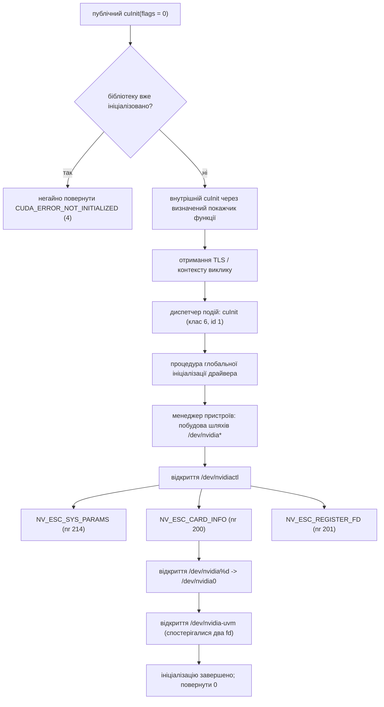

# 01 — Послідовність `cuInit` на GP107 / R580

## Середовище

Драйвер `580.196.11`, ядро `7.2.15+kali-amd64`, GPU `GP107 [GeForce GTX 1050 Ti]` (`10de:1c82`), SM 6.1. Цільова бібліотека: `/usr/lib/x86_64-linux-gnu/libcuda.so.1` → `libcuda.so.580.196.11`.

## Стислий висновок

`cuInit` — тонка публічна обгортка. Вона перевіряє, чи не ініціалізовано драйвер раніше, передає керування внутрішньому ініціалізатору через непрямий покажчик, визначений під час завантаження, і перетворює коди повернення на зрозумілі назви помилок. **Уся робота з пристроями та `ioctl` виконується нижче** — у внутрішньому ініціалізаторі та шарі керування пристроями.

Мінімальний виклик `dlopen("libcuda.so.1") + dlsym("cuInit") + cuInit(0)` на цій системі повернув `0`.

## Спостережуваний ланцюжок викликів



Диспетчер передає невеликий дескриптор події з міткою `6 / 1` і буквальним ім'ям `cuInit`; пізніше той самий диспетчер використовується під час виділення пам'яті та запуску ядра з іншими ідентифікаторами подій.

## Вузли пристроїв

| Вузол | Призначення в цьому шляху | Доказ |
|---|---|---|
| `/dev/nvidiactl` | Глобальний канал керування Resource Manager. Відкривається з `O_RDWR`; усі глобальні escape-`ioctl` проходять через нього. | Статична побудова шляху + `openat("/dev/nvidiactl", O_RDWR)` |
| `/dev/nvidia%d` → `/dev/nvidia0` | Вузол окремого GPU для фізичного чипа GP107. Шаблон береться з `minor_number` у `NV_ESC_CARD_INFO`. | `snprintf("/dev/nvidia%d", ...)` + `openat("/dev/nvidia0", O_RDWR\|O_CLOEXEC)` |
| `/dev/nvidia-uvm` | Пристрій Unified Memory; відкриваються два fd, після чого виконуються `UVM_INITIALIZE` та пов'язані операції налаштування. | `openat("/dev/nvidia-uvm", O_RDWR\|O_CLOEXEC)` ×2 |
| `/proc/driver/nvidia/params` | Це не вузол `/dev`; файл читається для отримання параметрів драйвера та метаданих вузлів. | `openat` під час `cuInit` |

У бібліотеці також присутні рядки, але під час звичайного `cuInit(0)` у цій системі **не відкривалися** такі вузли: `/dev/nvidia-modeset`, `/dev/nvidia-uvm-tools`, `/dev/nvidia-caps/nvidia-cap%d`, `/dev/nvidia-caps-imex-channels/channel%d`, `/dev/nvidia-nvlink`, `/dev/nvidia-nvswitch%d`, `/dev/nvidia-vgpu%d`. Сама наявність рядка не доводить, що вузол використовується в цьому шляху.

## Послідовність ioctl

Magic — `'F'` (`0x46`), із `nv-ioctl-numbers.h`.

| Запит ioctl | nr | Напрямок / розмір | Назва | Призначення |
|---|---:|---|---|---|
| `0xc00846d6` | 214 (`0xd6`) | RD/WR, 8 | `NV_ESC_SYS_PARAMS` | Запит системних параметрів (`uint64_t memblock_size`) |
| `0xc90046c8` | 200 (`0xc8`) | RD/WR, 2304 | `NV_ESC_CARD_INFO` | Перелік до 32 GPU (записи по 72 байти) |
| `0xc00446c9` | 201 (`0xc9`) | RD/WR, 4 | `NV_ESC_REGISTER_FD` | Реєстрація GPU fd через control fd |
| `0xc020462a` | 42 (`0x2a`) | RD/WR, 32 | `NV_ESC_RM_CONTROL` | Транспорт для команд RM (`NVOS54_PARAMETERS`) |
| `0xc0104629` | 41 (`0x29`) | RD/WR, 16 | `NV_ESC_RM_FREE` | Звільнення об'єктів RM |
| `0xc030462b` | 43 (`0x2b`) | RD/WR, 48 | `NV_ESC_RM_ALLOC` | Створення об'єктів RM (`NVOS64_PARAMETERS`) |
| `0xc23046d7` | 215 (`0xd7`) | RD/WR, 560 | внутрішній | Додатковий запит RM/стану |
| `0xc00c46d1` | 209 (`0xd1`) | RD/WR, 12 | `NV_ESC_STATUS_CODE` | Шлях обробки помилки, коли відкриття GPU завершується `EACCES` |
| `0xc00846d5` | 213 (`0xd5`) | RD/WR, 8 | `NV_ESC_QUERY_DEVICE_INTR` | Допоміжна процедура очікування завершення відкриття |
| `0xc00846da` | 218 (`0xda`) | RD/WR, 8 | `NV_ESC_WAIT_OPEN_COMPLETE` | Очікування завершення відкриття GPU |
| `0xca3046d9` | 217 (`0xd9`) | RD/WR, 2608 | `NV_ESC_EXPORT_TO_DMABUF_FD` | Гілка експорту DMABUF |

Номери нижче 200 походять із `nv_escape.h`, а не з публічного `nv-ioctl-numbers.h`; саме тому `0x2a` спочатку виглядав як такий, що не має зіставлення.

## Карта команд RM (`NVOS54_PARAMETERS.cmd`)

Структура `NVOS54_PARAMETERS`, яку використовує `NV_ESC_RM_CONTROL`:

| Зсув | Поле | Ширина |
|---:|---|---:|
| 0 | `hClient` | 32 |
| 4 | `hObject` | 32 |
| 8 | `cmd` | 32 |
| 12 | `flags` | 32 |
| 16 | `params` | 64 (покажчик) |
| 24 | `paramsSize` | 32 |
| 28 | `status` | 32 |

Команди, спостережені під час ініціалізації та зіставлені з відповідними `ctrl2080*.h`:

| `cmd` | Символ | Значення |
|---|---|---|
| `0x20803801` | `NV2080_CTRL_CMD_GRMGR_GET_GR_FS_INFO` | Інформація про framebuffer/engine graphics-manager |
| `0x20801346` | `NV2080_CTRL_CMD_FB_GET_FS_INFO` | Інформація про framebuffer для subdevice 0 |
| `0x00000101` | `NV0000_CTRL_CMD_CLIENT_GET_CAPABILITIES` | Можливості клієнта |

Префікс `0x2080` позначає клас `NV20_SUBDEVICE_0`; молодший байт — команду в інтерфейсі цього класу.

## Семантика кодів повернення (поведінка, не вихідний код)

- Коди `0` (успіх), `3`, `4` і `600` повертаються безпосередньо, без пошуку в журналі помилок.
- Для інших кодів виконується пошук у внутрішній таблиці помилок; знайдене ім'я (або резервне значення) виводиться в діагностику перед поверненням.
- Якщо глобальне слово стану має захисне значення, виконується раннє повернення `4`, коли бібліотека вважає, що її ще не ініціалізовано.

## Методика перевірки

1. Статичний аналіз `libcuda.so.580.196.11` за допомогою REA/Ghidra 12.2 (SHA-256 `20ad440390dad2c5fd06c14e518990512a8e7b31f8b6add7bb1581832fd4d331`). Зафіксовано лише потоки керування, графи викликів, константи та розкладки ABI.
2. `strace -f -e trace=openat,ioctl` для мінімального пробника `dlopen`/`dlsym`.
3. Константи ABI звірено з `/usr/src/nvidia-580.196.11/common/inc/` і відповідними `ctrl2080*.h` із дерева `NVIDIA/open-gpu-kernel-modules` з тегом `580.196.11`.

## Примітки щодо clean-room пробника (`probes/01_min_cuinit.c`)

Під час створення пробника без `libcuda` виявлено дві неочевидні вимоги:

1. **`NV_ESC_SYS_PARAMS` задається лише один раз.** Ядро зберігає перший отриманий `memblock_size` і повертає `EBUSY` для будь-якого наступного відмінного значення (`nv.c`: `if (nvl->numa_memblock_size == 0) ... else status = ... -EBUSY`). Тому сам драйвер перед ініціалізацією читає `/sys/devices/system/memory/block_size_bytes` — на цій машині `8000000` у hex = `134217728` байтів — і передає саме це значення. Clean-room пробник робить так само.
2. **`_IOWR()` приймає тип/вираз, а не числовий розмір.** Через `_IOC_TYPECHECK` у glibc передавання `sizeof(cards)` кодує розмір `sizeof(size_t) == 8`, а не `2304`; ядро бачить лише 8 байтів і повертає `EINVAL`. Треба передавати саму змінну: `_IOWR('F', 200, cards)`, `_IOWR('F', 201, ctl_fd)`, `_IOWR('F', 214, memblock_size)`.

Також зверніть увагу на напрямок `NV_ESC_REGISTER_FD`: `ioctl` викликається для **GPU** fd (`/dev/nvidia0`) з **control** fd як 4-байтовим аргументом, а не навпаки.

Підтверджені `ioctl` із завершеного пробника:

```text
ioctl(3, _IOC(RD/WR, 0x46, 0xd6, 0x8), ...)    = 0   NV_ESC_SYS_PARAMS
ioctl(3, _IOC(RD/WR, 0x46, 0xc8, 0x900), ...)  = 0   NV_ESC_CARD_INFO (32 x 72)
ioctl(4, _IOC(RD/WR, 0x46, 0xc9, 0x4), ...)    = 0   NV_ESC_REGISTER_FD
```

## Обмеження

- Ghidra статично визначає непрямий покажчик ініціалізатора, але його runtime-релокацію підтверджено спостереженням; інша збірка драйвера може змінити адреси.
- Деякі внутрішні номери escape-команд (наприклад, nr 215 із розміром 560) не мають публічної назви; вони наведені як спостережені, без спекулятивного найменування.
- Результати стосуються R580 + GP107; не слід припускати, що розкладки залишаються незмінними між основними гілками драйвера.
