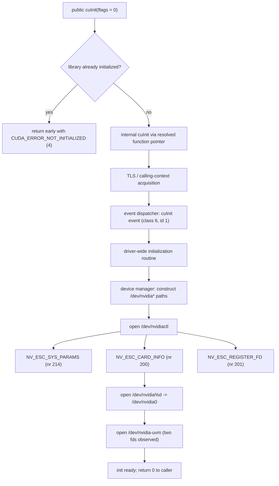

# 01 — `cuInit` flow on GP107 / R580

## Environment

Driver `580.196.11`, kernel `7.2.15+kali-amd64`, GPU `GP107 [GeForce GTX 1050 Ti]` (`10de:1c82`), SM 6.1. Target library: `/usr/lib/x86_64-linux-gnu/libcuda.so.1` → `libcuda.so.580.196.11`.

## Summary

`cuInit` is a thin public wrapper. It guards against an already-initialized driver, delegates to an internal initializer through an indirect pointer resolved at load time, and maps return codes to a readable error name. **All device and ioctl work happens below it**, in the internal initializer and device-manager layer.

A minimal `dlopen("libcuda.so.1") + dlsym("cuInit") + cuInit(0)` returned `0` on this system.

## Observed call flow



The dispatcher passes a small event descriptor tagged `6 / 1` and the literal label `cuInit`; the same dispatcher is reused later by allocation and launch with different event ids.

## Device nodes

| Node | Role in this path | Evidence |
|---|---|---|
| `/dev/nvidiactl` | Global Resource Manager control channel. Opened `O_RDWR`; all global escape ioctls go through it. | static path construction + `openat("/dev/nvidiactl", O_RDWR)` |
| `/dev/nvidia%d` → `/dev/nvidia0` | Per-GPU node for the physical GP107 chip. Template comes from `minor_number` in `NV_ESC_CARD_INFO`. | `snprintf("/dev/nvidia%d", ...)` + `openat("/dev/nvidia0", O_RDWR\|O_CLOEXEC)` |
| `/dev/nvidia-uvm` | Unified Memory device; two fds opened, then `UVM_INITIALIZE` and related setup. | `openat("/dev/nvidia-uvm", O_RDWR\|O_CLOEXEC)` x2 |
| `/proc/driver/nvidia/params` | Not a `/dev` node; read for driver parameters / node metadata. | `openat` under `cuInit` |

Strings also present in the library but **not opened by plain `cuInit(0)`** on this system: `/dev/nvidia-modeset`, `/dev/nvidia-uvm-tools`, `/dev/nvidia-caps/nvidia-cap%d`, `/dev/nvidia-caps-imex-channels/channel%d`, `/dev/nvidia-nvlink`, `/dev/nvidia-nvswitch%d`, `/dev/nvidia-vgpu%d`. Their presence alone does not imply use in this path.

## ioctl sequence

Magic is `'F'` (`0x46`), from `nv-ioctl-numbers.h`.

| ioctl request | nr | Direction / size | Name | Purpose |
|---|---:|---|---|---|
| `0xc00846d6` | 214 (`0xd6`) | RD/WR, 8 | `NV_ESC_SYS_PARAMS` | Query system parameters (`uint64_t memblock_size`) |
| `0xc90046c8` | 200 (`0xc8`) | RD/WR, 2304 | `NV_ESC_CARD_INFO` | Enumerate up to 32 GPUs (72-byte entries) |
| `0xc00446c9` | 201 (`0xc9`) | RD/WR, 4 | `NV_ESC_REGISTER_FD` | Register GPU fd with the control fd |
| `0xc020462a` | 42 (`0x2a`) | RD/WR, 32 | `NV_ESC_RM_CONTROL` | Transport for RM commands (`NVOS54_PARAMETERS`) |
| `0xc0104629` | 41 (`0x29`) | RD/WR, 16 | `NV_ESC_RM_FREE` | Release RM objects |
| `0xc030462b` | 43 (`0x2b`) | RD/WR, 48 | `NV_ESC_RM_ALLOC` | Create RM objects (`NVOS64_PARAMETERS`) |
| `0xc23046d7` | 215 (`0xd7`) | RD/WR, 560 | internal | Further RM/status query |
| `0xc00c46d1` | 209 (`0xd1`) | RD/WR, 12 | `NV_ESC_STATUS_CODE` | Error path when GPU open fails with `EACCES` |
| `0xc00846d5` | 213 (`0xd5`) | RD/WR, 8 | `NV_ESC_QUERY_DEVICE_INTR` | Open-completion wait helper |
| `0xc00846da` | 218 (`0xda`) | RD/WR, 8 | `NV_ESC_WAIT_OPEN_COMPLETE` | Wait for GPU open to finish |
| `0xca3046d9` | 217 (`0xd9`) | RD/WR, 2608 | `NV_ESC_EXPORT_TO_DMABUF_FD` | DMABUF export branch |

Numbers below 200 come from `nv_escape.h`, not from the public `nv-ioctl-numbers.h`; that is why `0x2a` initially looked "unmapped".

## RM command map (`NVOS54_PARAMETERS.cmd`)

`NVOS54_PARAMETERS` layout used by `NV_ESC_RM_CONTROL`:

| Offset | Field | Width |
|---:|---|---:|
| 0 | `hClient` | 32 |
| 4 | `hObject` | 32 |
| 8 | `cmd` | 32 |
| 12 | `flags` | 32 |
| 16 | `params` | 64 (pointer) |
| 24 | `paramsSize` | 32 |
| 28 | `status` | 32 |

Commands observed during initialization, resolved with matching `ctrl2080*.h`:

| `cmd` | Symbol | Meaning |
|---|---|---|
| `0x20803801` | `NV2080_CTRL_CMD_GRMGR_GET_GR_FS_INFO` | Graphics-manager framebuffer/engine info |
| `0x20801346` | `NV2080_CTRL_CMD_FB_GET_FS_INFO` | Framebuffer info for subdevice 0 |
| `0x00000101` | `NV0000_CTRL_CMD_CLIENT_GET_CAPABILITIES` | Client capabilities |

The `0x2080` prefix is class `NV20_SUBDEVICE_0`; the low byte is the command within that class's interface.

## Return-code semantics (behavioural, not source)

- Codes `0` (success), `3`, `4` and `600` are returned directly without a log lookup.
- Other codes are searched in an internal error table; the resolved name (or a fallback) is emitted in a diagnostic before returning.
- A guard value in a global state word causes an early `4` if the library believes it was never initialized.

## Verification method

1. Static analysis with REA/Ghidra 12.2 over `libcuda.so.580.196.11` (SHA-256 `20ad440390dad2c5fd06c14e518990512a8e7b31f8b6add7bb1581832fd4d331`). Only control flow, call graphs, constants and ABI layouts were recorded.
2. `strace -f -e trace=openat,ioctl` of a minimal `dlopen`/`dlsym` probe.
3. ABI constants cross-checked against `/usr/src/nvidia-580.196.11/common/inc/` and matching `ctrl2080*.h` from `NVIDIA/open-gpu-kernel-modules` tag `580.196.11`.

## Clean-room probe notes (`probes/01_min_cuinit.c`)

Two non-obvious requirements were found while making the no-`libcuda` probe work:

1. **`NV_ESC_SYS_PARAMS` is set-once.** The kernel stores the first `memblock_size` it receives and returns `EBUSY` for any later, different value (`nv.c`: `if (nvl->numa_memblock_size == 0) ... else status = ... -EBUSY`). The driver's own initialization therefore reads `/sys/devices/system/memory/block_size_bytes` first — on this machine `8000000` hex = `134217728` bytes — and passes that exact value. The clean-room probe does the same.
2. **`_IOWR()` takes a type/expression, not a size literal.** With glibc's `_IOC_TYPECHECK`, passing `sizeof(cards)` makes the encoded size `sizeof(size_t) == 8`, not `2304`; the kernel then sees only 8 bytes and returns `EINVAL`. Pass the variable itself: `_IOWR('F', 200, cards)`, `_IOWR('F', 201, ctl_fd)`, `_IOWR('F', 214, memblock_size)`.

Also note the direction of `NV_ESC_REGISTER_FD`: the ioctl is issued on the **GPU** fd (`/dev/nvidia0`) with the **control** fd as its 4-byte argument, not the other way around.

Verified ioctls from the finished probe:

```text
ioctl(3, _IOC(RD/WR, 0x46, 0xd6, 0x8), ...)    = 0   NV_ESC_SYS_PARAMS
ioctl(3, _IOC(RD/WR, 0x46, 0xc8, 0x900), ...)  = 0   NV_ESC_CARD_INFO (32 x 72)
ioctl(4, _IOC(RD/WR, 0x46, 0xc9, 0x4), ...)    = 0   NV_ESC_REGISTER_FD
```

## Limitations

- Ghidra resolves the indirect initializer pointer statically, but runtime relocation was confirmed by observation; a different driver build may change addresses.
- Some internal escape numbers (e.g. nr 215 with size 560) have no public name; they are listed as observed, not named speculatively.
- Results are specific to R580 + GP107; do not assume layout stability across major branches.
