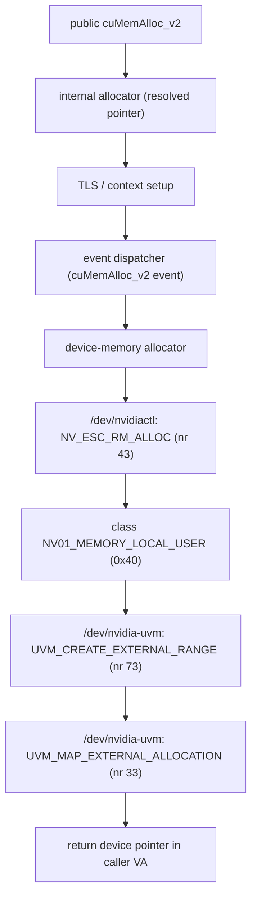
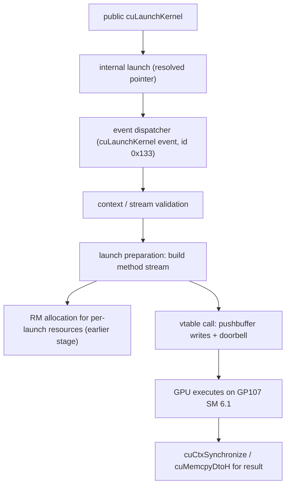

# 02 — `cuMemAlloc_v2` and `cuLaunchKernel` on GP107 / R580

Continuation of [01-cuInit-flow.md](01-cuInit-flow.md). Same environment: driver `580.196.11`, kernel `7.2.15+kali-amd64`, GP107 (`sm_61`).

## Allocation: `cuMemAlloc_v2(&dptr, 4096)`

`cuMemAlloc_v2` is again a thin wrapper over an indirect internal pointer. Allocation itself is split between the Resource Manager (device memory object) and UVM (virtual address range / mapping).



### Observed syscall sequence

Markers were written between API calls; an `LD_PRELOAD` interposer decoded RM parameter words.

| Stage | Call | Target fd | Decoded meaning |
|---|---|---|---|
| allocate | `ioctl(nr=0x2b, size=0x30)` | `/dev/nvidiactl` | `NV_ESC_RM_ALLOC`, `NVOS64_PARAMETERS` |
| allocate | `ioctl(req=0x49)` | `/dev/nvidia-uvm` | `UVM_CREATE_EXTERNAL_RANGE` |
| allocate | `ioctl(req=0x21)` | `/dev/nvidia-uvm` | `UVM_MAP_EXTERNAL_ALLOCATION` |
| free | `ioctl(req=0x22)` | `/dev/nvidia-uvm` | `UVM_FREE` |
| free | `ioctl(nr=0x29, size=0x10)` | `/dev/nvidiactl` | `NV_ESC_RM_FREE` |

### `NVOS64_PARAMETERS` observed for a 4096-byte allocation

| Offset | Observed value | Interpretation |
|---:|---|---|
| 0 | `0xc1d00042` | `hRoot` (client handle) |
| 4 | `0x5c000002` | `hObjectParent` (GPU/subdevice handle) |
| 8 | `0x5c000078` | `hObjectNew` (new memory handle) |
| 12 | `0x40` | `hClass` = `NV01_MEMORY_LOCAL_USER` |
| 16 | pointer | `pAllocParms` |
| 24 | `0` | `pRightsRequested` (null) |

The `0x40` class is defined in `class/cl0040.h` as `NV01_MEMORY_LOCAL_USER` (legacy alias `NV01_MEMORY_USER`). The UVM fd was mapped at a GPU virtual base such as `0x205a00000` via `mmap(..., MAP_SHARED|MAP_FIXED, uvm_fd, 0x205a00000)`.

### Relevant UVM ioctls

From `uvm_ioctl.h` / `uvm_linux_ioctl.h`:

| nr | Symbol | Role |
|---:|---|---|
| 1 | `UVM_INITIALIZE` | First operation on a UVM fd (`0x30000001`) |
| 23 | `UVM_CREATE_RANGE_GROUP` | Range groups |
| 25 | `UVM_REGISTER_GPU_VASPACE` | Register RM VA space with UVM |
| 33 | `UVM_MAP_EXTERNAL_ALLOCATION` | Map an RM allocation into UVM |
| 34 | `UVM_FREE` | Release UVM range |
| 37 | `UVM_REGISTER_GPU` | Register GPU with UVM |
| 39 | `UVM_PAGEABLE_MEM_ACCESS` | Query pageable access |
| 55 | `UVM_DISABLE_SYSTEM_WIDE_ATOMICS` | Setup |
| 73 | `UVM_CREATE_EXTERNAL_RANGE` | Create external VA range |
| 75 | `UVM_MM_INITIALIZE` | Secondary fd initialization |

## Launch: `cuLaunchKernel`

### Why there is no ioctl during launch

Markers `BEFORE_LAUNCH` / `AFTER_LAUNCH` around `cuLaunchKernel` produced **zero** ioctl calls. All objects, VA mappings, and channel resources were created earlier during context creation and allocation. Launch is performed by writing command methods into an already-mapped pushbuffer and ringing a hardware doorbell in mapped MMIO — ordinary CPU stores, not syscalls.



Observed mapped regions used by this path include:

```text
mmap(..., MAP_SHARED|MAP_FIXED, uvm_fd, 0x205a00000) = ...
mmap(..., MAP_SHARED|MAP_FIXED, nvidia0_fd, 0)        = ...
```

### Smoke test

A minimal PTX kernel targeting `sm_61` was JIT-loaded with `cuModuleLoadData`, launched with `grid=1x1x1`, `block=1x1x1`, wrote the constant `42` through a device pointer, and was read back with `cuMemcpyDtoH_v2`:

```text
cuInit(0) = 0
cuMemAlloc_v2: dptr = 0x...
cuLaunchKernel -> ok
kernel result = 42
```

Common pitfall for clean-room probes: the driver API's `kernelParams` argument is an array of **pointers to argument values**. For a `CUdeviceptr` parameter, pass `&dptr`, not `dptr`; passing the value directly causes a host-side segmentation fault before any RM call.

## Reproducing

Build and run the minimal no-libcuda probe:

```bash
make -C probes
./probes/01_min_cuinit
python3 scripts/decode_ioctl.py 0xc020462a 0x20803801
```

## Limitations

- The exact pushbuffer method offsets and doorbell register address are not documented here; they are internal to RM and vary by chip/revision.
- `NVOS64_PARAMETERS` field values include process-specific handles and will differ on every run.
- No claim is made that the same sequence applies to Volta or later architectures, or to other driver branches.
