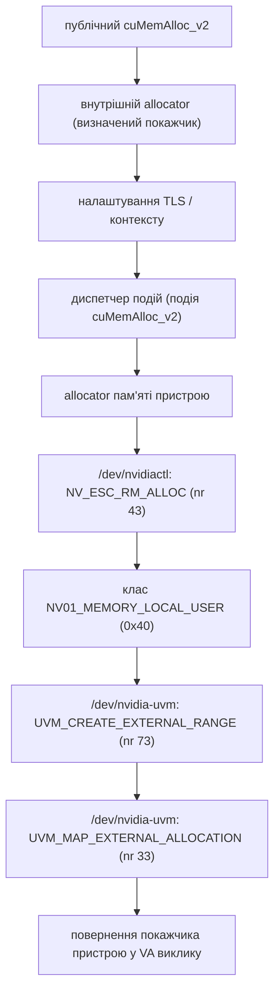
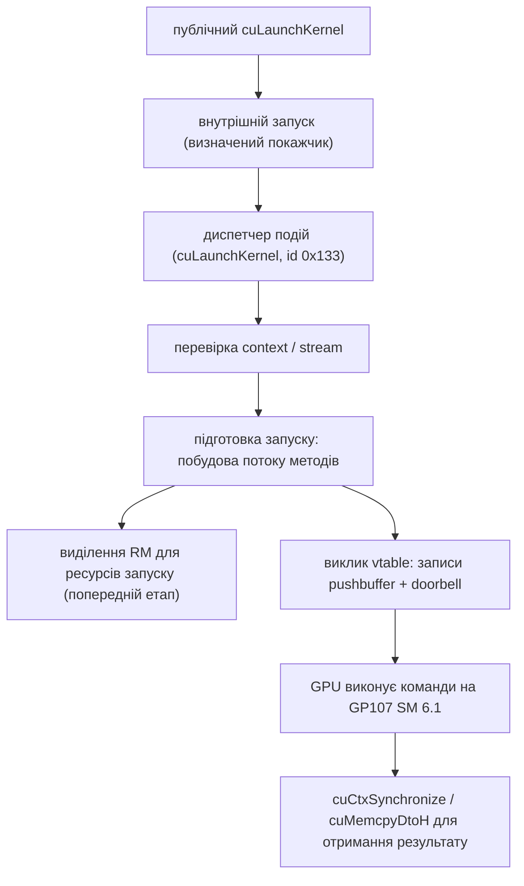

# 02 — `cuMemAlloc_v2` та `cuLaunchKernel` на GP107 / R580

Продовження документа [01-cuInit-flow.md](01-cuInit-flow.md). Те саме середовище: драйвер `580.196.11`, ядро `7.2.15+kali-amd64`, GP107 (`sm_61`).

## Виділення пам'яті: `cuMemAlloc_v2(&dptr, 4096)`

`cuMemAlloc_v2` знову є тонкою обгорткою над непрямим внутрішнім покажчиком. Саме виділення розділене між Resource Manager (об'єкт фізичної пам'яті пристрою) та UVM (діапазон віртуальних адрес і відображення).



### Спостережувана послідовність системних викликів

Маркери записувалися між викликами API; перехоплювач `LD_PRELOAD` декодував слова параметрів RM.

| Етап | Виклик | Цільовий fd | Розшифроване значення |
|---|---|---|---|
| виділення | `ioctl(nr=0x2b, size=0x30)` | `/dev/nvidiactl` | `NV_ESC_RM_ALLOC`, `NVOS64_PARAMETERS` |
| виділення | `ioctl(req=0x49)` | `/dev/nvidia-uvm` | `UVM_CREATE_EXTERNAL_RANGE` |
| виділення | `ioctl(req=0x21)` | `/dev/nvidia-uvm` | `UVM_MAP_EXTERNAL_ALLOCATION` |
| звільнення | `ioctl(req=0x22)` | `/dev/nvidia-uvm` | `UVM_FREE` |
| звільнення | `ioctl(nr=0x29, size=0x10)` | `/dev/nvidiactl` | `NV_ESC_RM_FREE` |

### Спостережені `NVOS64_PARAMETERS` для виділення 4096 байтів

| Зсув | Спостережене значення | Інтерпретація |
|---:|---|---|
| 0 | `0xc1d00042` | `hRoot` (handle клієнта) |
| 4 | `0x5c000002` | `hObjectParent` (handle GPU/subdevice) |
| 8 | `0x5c000078` | `hObjectNew` (handle нового об'єкта пам'яті) |
| 12 | `0x40` | `hClass` = `NV01_MEMORY_LOCAL_USER` |
| 16 | покажчик | `pAllocParms` |
| 24 | `0` | `pRightsRequested` (null) |

Клас `0x40` визначений у `class/cl0040.h` як `NV01_MEMORY_LOCAL_USER` (застарілий псевдонім `NV01_MEMORY_USER`). fd UVM відображався за базовою GPU-віртуальною адресою на кшталт `0x205a00000` через `mmap(..., MAP_SHARED|MAP_FIXED, uvm_fd, 0x205a00000)`.

### Доречні `ioctl` UVM

Із `uvm_ioctl.h` / `uvm_linux_ioctl.h`:

| nr | Символ | Призначення |
|---:|---|---|
| 1 | `UVM_INITIALIZE` | Перша операція над fd UVM (`0x30000001`) |
| 23 | `UVM_CREATE_RANGE_GROUP` | Групи діапазонів |
| 25 | `UVM_REGISTER_GPU_VASPACE` | Реєстрація простору віртуальних адрес RM |
| 33 | `UVM_MAP_EXTERNAL_ALLOCATION` | Відображення алокації RM в UVM |
| 34 | `UVM_FREE` | Звільнення діапазону UVM |
| 37 | `UVM_REGISTER_GPU` | Реєстрація GPU в UVM |
| 39 | `UVM_PAGEABLE_MEM_ACCESS` | Запит щодо доступу до pageable memory |
| 55 | `UVM_DISABLE_SYSTEM_WIDE_ATOMICS` | Налаштування |
| 73 | `UVM_CREATE_EXTERNAL_RANGE` | Створення зовнішнього VA-діапазону |
| 75 | `UVM_MM_INITIALIZE` | Ініціалізація другого fd |

## Запуск: `cuLaunchKernel`

### Чому під час запуску немає `ioctl`

Маркери `BEFORE_LAUNCH` / `AFTER_LAUNCH` навколо `cuLaunchKernel` показали **нуль** викликів `ioctl`. Усі об'єкти, відображення VA та ресурси каналу створюються раніше — під час створення контексту й виділення пам'яті. Сам запуск виконується записом командних методів у вже відображений pushbuffer і поданням сигналу апаратному doorbell у відображеному MMIO. Це звичайні записи CPU, а не системні виклики.



Спостережені області відображення, які використовує цей шлях:

```text
mmap(..., MAP_SHARED|MAP_FIXED, uvm_fd, 0x205a00000) = ...
mmap(..., MAP_SHARED|MAP_FIXED, nvidia0_fd, 0)        = ...
```

### Перевірка працездатності

Мінімальне PTX-ядро для `sm_61` було JIT-завантажене через `cuModuleLoadData`, запущене з `grid=1x1x1`, `block=1x1x1`, записало константу `42` через покажчик пристрою, а значення було прочитано назад за допомогою `cuMemcpyDtoH_v2`:

```text
cuInit(0) = 0
cuMemAlloc_v2: dptr = 0x...
cuLaunchKernel -> ok
kernel result = 42
```

Поширена помилка в clean-room пробниках: аргумент `kernelParams` API драйвера — це масив **покажчиків на значення аргументів**. Для параметра `CUdeviceptr` треба передавати `&dptr`, а не `dptr`; передавання самого значення спричиняє помилку сегментації на стороні host ще до будь-якого виклику RM.

## Відтворення

Зібрати й запустити мінімальний пробник без `libcuda`:

```bash
make -C probes
./probes/01_min_cuinit
python3 scripts/decode_ioctl.py 0xc020462a 0x20803801
```

## Обмеження

- Точні зсуви методів pushbuffer та адреса регістра doorbell тут не документуються: вони є внутрішніми для RM і залежать від чипа/ревізії.
- Значення полів `NVOS64_PARAMETERS` містять handles конкретного процесу й відрізнятимуться під час кожного запуску.
- Не стверджується, що така сама послідовність діє для Volta або новіших архітектур чи для інших гілок драйвера.
